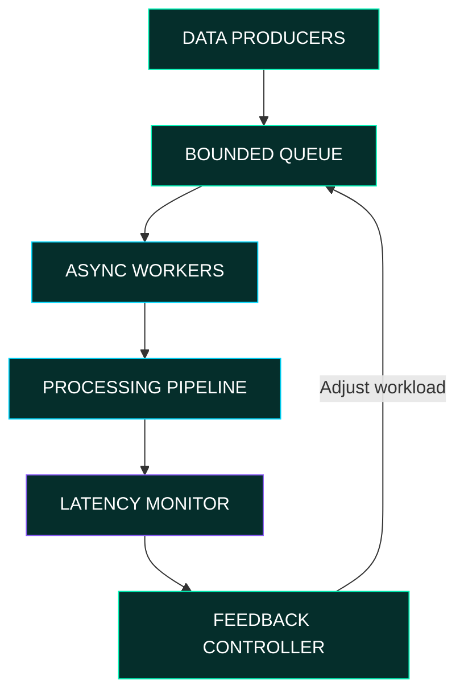

<!-- ====================================================== -->
<!--              MERAOL ALEMAYEHU | GITHUB                 -->
<!--              NEON SYSTEMS ENGINEERING                  -->
<!-- ====================================================== -->

<div align="center">


<br/>


<br/>


<br/><br/>

<a href="https://github.com/MeraolAlemayehu">

</a>
<a href="https://linkedin.com/in/meraol-alemayehu-b0461a251">

</a>

<br/><br/>

<kbd> RUST </kbd> <kbd> PYTHON </kbd> <kbd> AI SYSTEMS </kbd> <kbd> DISTRIBUTED COMPUTING </kbd>

<br/><br/>


</div>

<br/>

<!-- ABOUT -->

<h2 align="center">
  <code>01 / THE ENGINEER</code>
</h2>

<div align="center">

### Engineering systems that perform. Building intelligence that scales.

</div>

I am a software engineer and technical project management professional from Ethiopia, working at the intersection of **systems programming, artificial intelligence, backend engineering, and technical leadership**.

I am particularly interested in understanding what happens beneath software abstractions: memory, concurrency, asynchronous execution, data flow, latency, and computational performance.

My engineering direction combines low-level systems development with intelligent software architectures.

<br/>

<div align="center">

|  | Systems programming and performance engineering |
|:---|:---|
|  | Machine learning and intelligent systems |
|  | APIs and scalable software architecture |
|  | Agile delivery and technical leadership |

</div>

---

<!-- CURRENT OPERATIONS -->

<h2 align="center">
  <code>02 / ENGINEERING OPERATIONS</code>
</h2>

<div align="center">


<br/><br/>


</div>

```rust
struct EngineeringProfile {
    name: &'static str,
    location: &'static str,
    primary_languages: [&'static str; 2],
    interests: [&'static str; 4],
}

fn main() {
    let engineer = EngineeringProfile {
        name: "Meraol Alemayehu",
        location: "Ethiopia",
        primary_languages: ["Rust", "Python"],
        interests: [
            "Systems Engineering",
            "Artificial Intelligence",
            "Distributed Systems",
            "Performance Optimization",
        ],
    };
}
```

---

<!-- RESEARCH -->

<h2 align="center">
  <code>03 / RESEARCH LAB</code>
</h2>

<div align="center">


### ADAPTIVE BACKPRESSURE CONTROL

**Rust Asynchronous Data Pipelines Using a Latency-Feedback Algorithm**


</div>

My MSc Computer Science research investigates adaptive workload regulation in asynchronous Rust data pipelines through latency-feedback control.

**Research objectives**

- Investigate adaptive backpressure mechanisms.
- Monitor and analyze processing latency.
- Regulate workload based on observed system behavior.
- Evaluate throughput, latency and resource utilization.
- Benchmark adaptive and fixed workload configurations.

### System architecture



**Research technology**


`Tokio` · `Async/Await` · `Latency Analysis` · `Benchmarking` · `Feedback Control`

---

<!-- TECHNOLOGY STACK -->

<h2 align="center">
  <code>04 / TECHNOLOGY ECOSYSTEM</code>
</h2>

<div align="center">

### SYSTEMS & PROGRAMMING


<br/><br/>

### ARTIFICIAL INTELLIGENCE & DATA


<br/><br/>

### BACKEND & INFRASTRUCTURE


</div>

---

<!-- PROJECTS -->

<h2 align="center">
  <code>05 / ENGINEERING PROJECTS</code>
</h2>

<div align="center">

<a href="https://github.com/MeraolAlemayehu?tab=repositories">

</a>

</div>

| ENGINEERING AREA | PROJECT DIRECTION |
|:---|:---|
| Rust Systems | Ownership, concurrency and asynchronous execution |
| Adaptive Backpressure | Latency-feedback workload regulation |
| AI Engineering | Machine learning and intelligent applications |
| Backend Engineering | API development and system architecture |

---

<!-- EDUCATION -->

<h2 align="center">
  <code>06 / ACADEMIC BACKGROUND</code>
</h2>

<div align="center">

**MSc Computer Science**

Ambo University

<br/>

**MSc Project Management**

In Progress

<br/>

**BSc Information Technology**

Arba Minch University

</div>

---

<!-- CONNECT -->

<h2 align="center">
  <code>07 / ESTABLISH CONNECTION</code>
</h2>

<div align="center">

<a href="https://linkedin.com/in/meraol-alemayehu-b0461a251">

</a>

<a href="https://kaggle.com/meraolalemayehu">

</a>

<a href="mailto:meralex3939@gmail.com">

</a>

<br/><br/>


### <code>BUILD SYSTEMS · MEASURE PERFORMANCE · ENGINEER INTELLIGENCE</code>

<sub>Designed and engineered by Meraol Alemayehu</sub>

</div>
